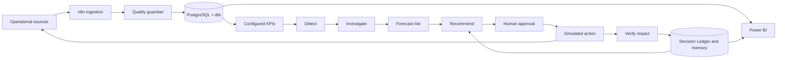

# Closed-Loop Decision Intelligence Platform

### n8n-orchestrated analytics, decision automation and impact measurement

**A recommendation is not the end of an analytical workflow. Its measured outcome is.**

This portfolio follows a business incident from validated source data to an
evidence-backed recommendation, explicit approval, simulated action, measured effect,
and a durable Decision Ledger. It uses a fictional European commerce/SaaS company,
**Lumen Commerce Cloud**. All data, incidents and actions are synthetic.

An ordinary dashboard shows what changed and leaves investigation and follow-through
to people. This project makes those steps inspectable and testable while retaining
human control. The stack runs locally without paid cloud services.

## Verification status

The Python/SQL offline rehearsal completes the checkout demo and writes a measured
outcome. Generated-data tests detect Germany Mobile checkout failures and distinguish
a tracking outage from business collapse. API and lifecycle tests cover authentication,
expiry, duplicate action requests, missing impact windows and ledger closure.

Docker Compose validates and dbt parses. **The Docker engine was unavailable during
the build; PostgreSQL/dbt execution and n8n runtime imports are not verified.** The
explicit SQLite rehearsal is a test adapter, not a replacement for PostgreSQL.
Power BI includes a semantic model, DAX measures and a report specification; the
Desktop report is pending implementation.

See [validation evidence](docs/validation.md), [computed evaluation](docs/evaluation.md),
and [limitations](#limitations) before interpreting the results.

## Architecture



n8n is the control plane. FastAPI exposes bounded use cases. Python performs quality,
statistics and decisions; SQL/dbt transforms warehouse data. PostgreSQL holds source
facts, monitoring history and decision memory. Separate domain packages keep
statistics independent of HTTP and workflow definitions.

## Stack and repository

Python 3.12+, pandas, NumPy, SciPy, scikit-learn, statsmodels, Pydantic, SQLAlchemy,
psycopg, FastAPI, dbt Core/PostgreSQL, pytest, Docker Compose, n8n and Power BI Desktop.
`requirements.txt` declares ranges; `requirements.lock` records the tested environment.

```text
config/          metrics, anomaly/decision rules and validated settings
src/             ingestion, quality, metrics, detection, investigation, forecasting,
                 decision_engine, impact, memory, synthetic_data and evaluation
api/             authenticated API and application-stage composition
database/        PostgreSQL initialization and Decision Ledger migration
dbt/             staging, intermediate, analytical marts and data tests
n8n/workflows/   eleven inactive importable workflow exports
sql/             shared aggregation and investigation queries
tests/           unit, generated-data, API/storage and opt-in PostgreSQL checks
powerbi/         semantic model, DAX and nine-page report specification
docs/            architecture, dictionaries, methodology, results and interview story
scripts/         setup, demo, contract generation and verification utilities
data/            ignored generated data/exports; small reviewed samples
```

## Installation and Docker setup

Install Python 3.12+ and Docker Desktop with its Linux-container engine running.
Run from this repository. On Windows, `py -3.12` can replace `python` if available.

```powershell
python -m venv .venv
.venv\Scripts\python -m pip install --no-cache-dir -r requirements.lock
.venv\Scripts\python scripts/configure.py
docker compose config --quiet
docker compose up -d --build
docker compose exec api python -m src.cli generate-data --months 24 --seed 42
docker compose exec api python -m src.cli transform
docker compose exec api python -m src.cli run-pipeline
```

`configure.py` creates independent random secrets and preserves an existing `.env`.
Source loading is atomic and refuses to mix simulations in a populated database.
`transform` runs **dbt build**, including model/data tests. The pipeline runs quality,
transformation, KPIs, detection, investigation, forecasts and recommendations, then
stops at pending human approval. Individual stages are also callable by n8n.

Equivalent dbt commands inside the container:

```sh
docker compose exec api dbt run --project-dir dbt --profiles-dir dbt
docker compose exec api dbt test --project-dir dbt --profiles-dir dbt
```

Open [n8n](http://localhost:5678), [FastAPI OpenAPI](http://localhost:8000/docs), and
connect PostgreSQL at `localhost:5432`. Host ports bind to loopback. Named volumes
persist PostgreSQL and n8n state. n8n's orchestration store is separate from the
PostgreSQL analytical warehouse.

### Import n8n workflows

Follow [n8n/README.md](n8n/README.md) to import all eleven workflows, configure the
webhook Header Auth credential, and activate them. Start workflow 01 manually.
The first seven stages lead to pending approval; workflow 08 polls for a human
decision. n8n has no human-approval token and cannot approve on its own.

## One-command demonstration

After startup:

```powershell
docker compose exec api python -m src.cli demo
```

Or run `bash scripts/demo_incident.sh` / `scripts/demo_incident.ps1`. The command
generates sources if needed, runs analytics if no recommendations exist, prints the
detected rollback recommendation, and waits for `APPROVE`. It executes only a local
simulation, advances seven synthetic days, measures impact, and writes
`data/exports/demo_ledger.json`.

The source timeline has a **13:48 checkout-v2 release** followed by **14:05 Germany
Mobile observations**. Daily anomaly timestamps label buckets; they do not claim
minute-resolution detection. Investigation checks the 17-minute deployment proximity
and observed payment/checkout errors. Read the stored contribution evidence to see
which segments explain the revenue movement.

For automated testing only, `demo --approve-simulation --actor test-operator` explicitly
records a simulated approval. The verified run uses `automated-demo-validation`, not
a claim that a real user approved a production action. The CLI exercises the domain
services; it is not evidence that n8n itself executed the workflow.

### Offline rehearsal

```powershell
.venv\Scripts\python -m src.cli --offline generate-data --months 24 --seed 42
.venv\Scripts\python -m src.cli --offline run-pipeline
.venv\Scripts\python -m src.cli --offline demo
.venv\Scripts\python -m src.cli --offline evaluate
```

The database selected by `OFFLINE_DATABASE` (default `data/generated/offline.db`)
flattens schemas and runs the shared portable SQL. It
does not execute PostgreSQL or dbt. Generated data stays out of Git. Two years create
roughly two million operational rows and can take several minutes. To serve this
rehearsal through FastAPI, set `DATABASE_URL` to the absolute SQLite file URL before
starting `uvicorn api.main:app`; this remains an explicitly offline mode.

## Warehouse and analytical methods

Schemas: `raw`, `staging`, `analytics`, `monitoring`, `decision`, `audit`, and isolated
`simulation` ground truth. Thirty-one tables have primary keys, relevant foreign
keys, uniqueness/check constraints, indexes and processing timestamps. dbt builds
analytical facts/dimensions and the cohort mart. See the [data dictionary](docs/data_dictionary.md).

The generator links orders, payments and refunds to customers, products and traffic
cohorts. Spend influences traffic; checkout failures reduce paid orders/revenue;
support pressure lowers satisfaction and increases churn after a lag. Trends,
weekdays, annual seasonality and planned promotions coexist with six hidden incident
scenarios. Ground truth never enters detection or recommendation rules.

Quality checks cover schema, nulls, duplicates, references, impossible values,
freshness, missing days, row counts, volume and distribution shifts. An independent
server-session feed identifies tracking failures. Critical failures stop analytics;
conversion alerts are suppressed on tracking-failure days. Replay freshness uses the
source watermark; the validator also accepts an explicit live as-of timestamp.

Nineteen configured metrics include revenue, orders, conversion, AOV, CAC, ROAS,
refunds, payment failures, churn/retention, support, margin and distinct customers.
Ratios are recomputed from summed components; zero denominators remain missing.
The [metric dictionary](docs/metric_dictionary.md) explains definitions and limitations.

Detection combines static thresholds, rolling z-score, robust MAD, rolling baseline,
EWMA, seasonal baseline and Isolation Forest. It applies adverse-direction, deviation,
duration and quality gates. Rolling baselines exclude the current point; the forest
uses only initial history. Scores are heuristics, not probabilities.
Count-aware tail tests additionally guard sparse payment, churn, conversion and
acquisition observations; a small count doubling is not automatically strong evidence.

Investigation ranks contributions independently by country, device, combined scope,
channel, category, segment, campaign, provider, hour and new/returning status. It
adds cross-metric ratios, operational context and deployment proximity. These are
likely drivers and supporting evidence, not proven causes.

Forecasts use damped additive Holt-Winters with approximate predictive intervals for
revenue, orders, conversion, churn, CAC and support. Daily horizons support 7/30-day
views. Exposure is a persistent-shortfall scenario and cannot be added across
overlapping incidents.

## Decisions, approval, impact and learning

YAML rules produce recommendations with evidence, confidence, a policy target, risk
and prior outcomes. Separate service and human credentials gate approval. Unique
action keys and PostgreSQL row locks protect retries. No production deployment,
campaign, payment-provider, email or Slack connector is called.

Only rollback currently has a validated recovery simulator and impact model. Seven
complete pre/post days compare Germany Mobile conversion with Germany Desktop through
scaled difference in differences and a paired day bootstrap. Missing windows produce
a waiting state. Other actions do not fabricate impact. The [ledger methodology](docs/decision_ledger.md)
documents policy targets, assumptions, classifications and uncertainty.

Memory retrieves earlier closed incidents by metric, scope and driver, including
actual outcomes. It supports review and never bypasses approval or silently retrains
rules. `/operations/kpis` reports processing-clock timings, approval/success rates,
impact error and pipeline health. Unidentifiable monetary protection and minute-level
MTTD remain unavailable rather than invented.

## API

Business endpoints require `X-API-Key`; approval/rejection additionally require
`X-Approval-Token`. Health is public. FastAPI generates OpenAPI and input schemas.

| Purpose | Endpoints |
|---|---|
| Analytics | `POST /analytics/run-kpis`, `/analytics/detect-anomalies`, `/analytics/investigate/{id}`, `/analytics/forecast/{id}` |
| Decisions | `POST /decisions/recommend/{id}`; `GET /incidents`, `/incidents/{id}`, `/recommendations/{id}` |
| Human control | `POST /recommendations/{id}/approve` or `/reject`; actor and rejection reason |
| Action/impact | `POST /actions/execute/{id}`, `/simulation/advance/{id}`, `/impact/verify/{id}` |
| Learning | `GET /decision-ledger`, `/decision-memory/similar/{id}`, `/operations/kpis` |
| n8n stages | `POST /orchestration/{stage}` |

## Testing and evaluation

```powershell
.venv\Scripts\python -m pytest
.venv\Scripts\python -m ruff check src api scripts tests
.venv\Scripts\python -m src.cli --offline evaluate
```

The PostgreSQL integration test requires `TEST_DATABASE_URL` for an isolated test
database; without it pytest explicitly skips that check. Scratch files stay in the
workspace to avoid Windows temporary-directory permission problems.

Evaluation compares persisted alerts with hidden truth: global metric-day precision
and false-positive rate, all-scope episode recall, bucket-level delay, driver match
and severity match. The inventory miss exposed a global-only incident policy; the
scope correction and development use of labels are disclosed. This is a smoke
evaluation, not an independent benchmark. The revised development run detects all
six episodes, with 95.7% global alert precision and 93.0% precision across all scopes.
The original run's sparse-count false alerts are retained in
`data/samples/evaluation_initial.json`: 59.5% global precision and 8.7% all-scope precision.
The count-aware gates reduced alerts from 13,016 to 844. These same-seed development
results require independent validation before any operational use.

The [computed report](docs/evaluation.md) and [ledger sample](data/samples/demo_ledger.json)
contain actual outputs. Regenerate them after changing rules or sources.

## Power BI and documentation

The [Power BI package](powerbi/README.md) supplies connections, a semantic model, DAX
and nine pages: Executive Intelligence, KPI Observatory, Anomaly Command Center,
Investigation, Forecast & Risk, Decision Center, Decision Impact, Quality & Pipeline
Health, and Automation Performance. The Desktop report and screenshots are pending
implementation.

Read the [six architecture diagrams](docs/architecture.md), [workflow architecture](docs/n8n_architecture.md),
[ledger design](docs/decision_ledger.md), [phase validation log](docs/validation.md),
and [30-second / 2-minute / 5-minute interview story](docs/interview_story.md).

## Limitations

Docker runtime checks remain outstanding on this host. Real-source ingestion,
intraday history, independent-seed calibration, cohort retention, causal incident
deduplication, action-impact models beyond rollback and monetary protection estimates
are future work. Forecast and seven-day impact intervals have limited calibration.
Synthetic replay is not a real experiment. Replace the local owner database role and
shared approval token with least-privilege roles and verified identities before any
shared deployment.

Further work includes incremental dbt, source watermarks/CDC, a job queue and advisory
locks, an action outbox, connector credentials, SSO/RBAC, TLS, tested backups/restores,
drift monitoring and independent causal evaluation. None is represented as implemented.

## Development

See [CONTRIBUTING.md](CONTRIBUTING.md) for setup and validation commands. GitHub Actions
runs Python checks and a PostgreSQL schema/dbt build check on pushes and pull requests.
The workflow's first hosted run is pending publication. See [CHANGELOG.md](CHANGELOG.md)
for the initial release scope and [publishing instructions](docs/publishing.md) to
upload the repository.
