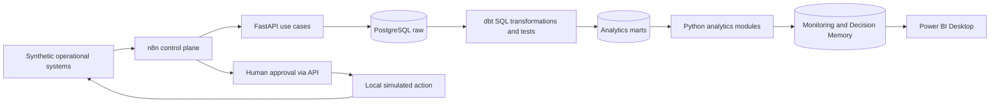
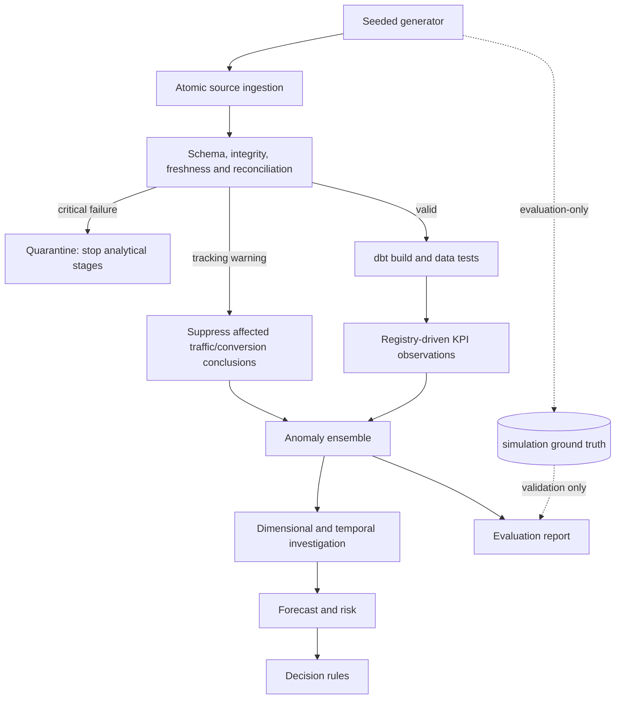
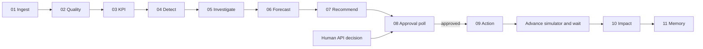
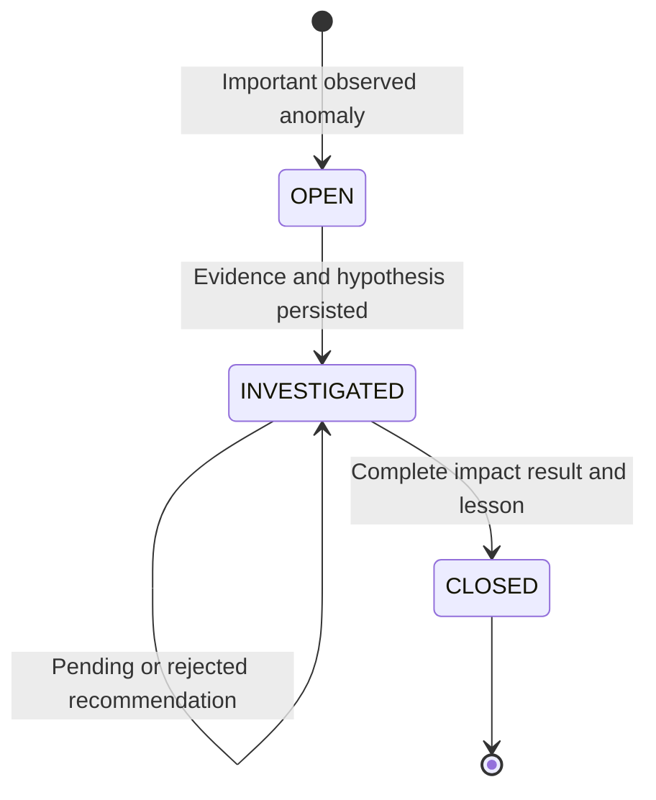
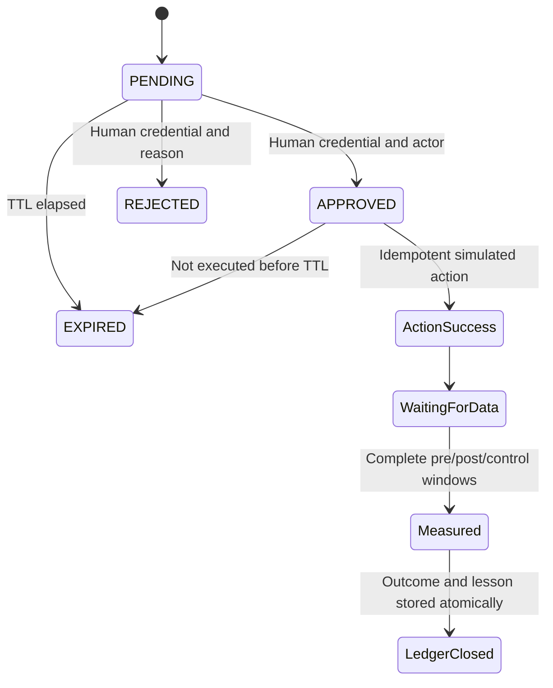
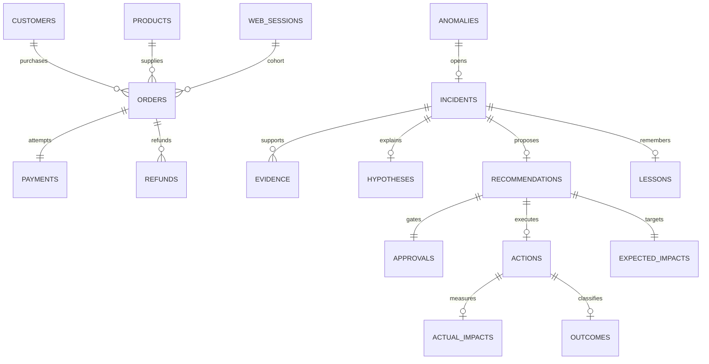

# Architecture and design decisions

This repository is a modular analytical platform for a fictional commerce/SaaS
business. It is not a production deployment or a generic dashboard application.
The deployment unit is an API container, with separate domain packages, SQL models,
warehouse schemas, and eleven workflow definitions. No statistical code runs in n8n.

## System architecture

## Data flow

## n8n workflow flow

## Incident lifecycle

## Decision lifecycle

## Warehouse relationships

## Boundaries and tradeoffs

- PostgreSQL is the production-shaped warehouse. The explicit SQLite adapter exists
  only for offline rehearsals and tests; it flattens schemas and executes the shared
  portable aggregation SQL. It does not validate PostgreSQL locking or dbt execution.
- dbt owns staging, intermediate aggregation and Power BI marts. The portable query
  and generated dbt intermediate model share the same SQL definition; dbt tests add
  uniqueness, nullability, foreign-key relationships and revenue reconciliation.
- Custom quality checks avoid introducing a second validation framework. Critical
  integrity failures stop processing. Tracking problems are scoped warnings because
  independent server traffic and transactional orders remain available.
- Seven anomaly methods vote on adverse movements. Seasonal baselines use prior
  same-weekday observations. Isolation Forest trains only on the initial 56 days.
  Scores are heuristics, not probabilities; multiple testing and model drift require
  additional calibration before operational use.
- Count-aware gates use binomial tails for conversion/payment/churn, Poisson tails
  for count metrics and an acquisition-count log-ratio approximation for CAC.
  Conservative baseline uncertainty prevents tiny counts from becoming severe
  incidents merely because they doubled. This is model-based filtering, not a
  guarantee of calibrated false-discovery control across all correlated metrics.
- Incident scopes and minimum scores are configured. Consecutive related alerts
  within seven days coalesce by metric and scope; causal cross-metric deduplication
  is not implemented. Similar incidents may therefore share a underlying event.
- Forecasts use damped additive Holt-Winters, fitted before the incident. Approximate
  predictive intervals are not empirically calibrated. Exposure assumes the observed
  shortfall persists and must not be summed across overlapping incidents.
  Unreliable conversion observations on tracking-outage days are excluded from fitting
  and replaced with strictly prior same-weekday medians to preserve calendar alignment.
  Model audit records expose imputed-row counts; intervals do not fully quantify
  imputation uncertainty.
- Actions are simulated acknowledgments. Only rollback has a recovery and impact
  model. Other action types deliberately return an unsupported-impact status instead
  of fabricated success. Extending them requires source response and control designs.
- Daily feeds support reaggregation to daily/weekly/monthly buckets. Hourly grouping
  is available, but the source snapshots do not constitute realistic intraday history.
  The 13:48 deployment and 14:05 observation demonstrate temporal evidence, not
  minute-resolution detector latency. Anomaly timestamps label the daily bucket.
- PostgreSQL row locks and unique recommendation/action keys protect approval and
  action transitions. For real external actions, add an outbox, external idempotency
  keys, worker leases, dead-letter queues and reconciliation of uncertain outcomes.
- One API worker and one sequential workflow chain are the supported local operating
  model. Warehouse-wide concurrent dbt rebuilds and simultaneous initial ingestion
  require an advisory lock/job queue before scaling.

## Production hardening

Use separate ingestion, transformation, analytics, BI and evaluation database roles;
deny runtime analytics access to simulation labels. The local Compose owner role is
not a least-privilege production identity. Add SSO/RBAC for approvers, TLS, a secret
manager, retention policies, off-host backups and tested restores. Replace replay
feeds with source connectors and watermarks, add schema-versioned contracts, and
validate false positives across independent seeds and real business regimes.
