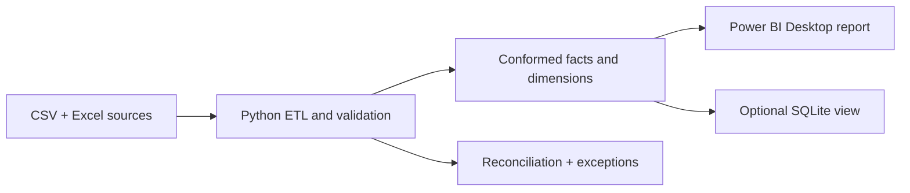

# Financial Project Performance & BI Dashboard

An end-to-end, reproducible financial analytics portfolio project using **synthetic demonstration data**. It models 40 fictional client projects, validates Excel and CSV sources, builds a conformed financial model, forecasts remaining cost, tests financial reconciliation, and includes an editable seven-page Power BI Desktop report. The figures are invented for demonstration and are not results from a real company.

## Business challenge and objectives

Project leadership needs to see approved budgets, actual cost, recognized revenue, margins, likely overruns, and the records behind anomalies in one report. This implementation separates budget versions from transactions, preserves valid accounting corrections, and surfaces source exceptions so financial conclusions can be traced and challenged.



The detailed architecture is in [docs/architecture.md](docs/architecture.md); the entity relationship diagram and fact grains are in [docs/data_model.md](docs/data_model.md).

## Stack and data

Python 3.12+, pandas, NumPy, openpyxl for reading the included Excel source, pytest, Power Query M, DAX, Power BI Desktop, optional SQLite, Git, and VS Code. The fixed seed is `20261009`; reporting spans January 2024 through September 2026, with future forecast months through planned completion. `data/raw/budgets.xlsx` is a formatted Excel copy of the deterministic `budgets.csv`; the ETL reads the workbook when present. The other sources are CSV. Source generation includes controlled invalid cost records so quality handling can be demonstrated.

## Open the report

Open [Financial Project Performance.pbip](powerbi/Financial%20Project%20Performance.pbip) in Power BI Desktop. The seven-page report carries its small, synthetic September 2026 reporting snapshot inside the semantic model, so it does not depend on the original creator's file paths. If Desktop shows an incomplete-data banner on first open, select **Refresh now**. The project file, report definition, and model definition belong together in the `powerbi/` folder.

## Rebuild from source

```powershell
cd financial-project-performance-bi
py -3.12 -m venv .venv
.\.venv\Scripts\Activate.ps1
python -m pip install -r requirements.txt
python run_pipeline.py --regenerate
python -m src.analytics.scenarios
python -m scripts.build_pbir
python -m scripts.validate_pbir
python -m pytest -q --basetemp .pytest_tmp
python -m scripts.package
```

The `--regenerate` step writes fixed-seed CSV sources, then the ETL reads `budgets.xlsx` if present and exports `data/curated/*.csv` plus `reports/*`. The checked-in workbook mirrors the standard-seed budget CSV. If you change the budget generation rules, move the workbook aside before running the pipeline so the new CSV is used. `scripts.build_pbir` regenerates the compact reporting marts and embeds them into the Power BI model; reopen the PBIP and refresh to see updated values. Configure the seed, as-of date, and scenario multipliers in `config/settings.json`.

Optional SQL copy:

```powershell
python -m scripts.load_sqlite
```

The SQLite file is written to `data/staging/financial_bi.db`; query `v_project_financials` and compare with `sql/reconciliation/checks.sql`. The database is an optional analytical mirror, not a second source of truth.

## Model and calculations

`FactBudget` is one project-version-department allocation; `FactActualCost` is one signed transaction; `FactRevenue` is one recognition posting; `FactForecast` is one project-snapshot-scenario-future month. Dimensions cover project, date, department, category, client, project manager, and budget version. [The data dictionary](docs/data_dictionary.md) lists key fields. Latest approved budget is selected as of the configured date; only the latest valid base forecast snapshot contributes to the headline ETC/EAC. `ProjectMetrics.csv` is a diagnostic extract and should **not** be joined back to the facts in Power BI.

The KPI catalog in [docs/kpi_definitions.md](docs/kpi_definitions.md) defines 27 measures, sign conventions, validation methods, and fixed-seed examples. Budget variance is `budget − actual`, so negative is unfavorable. Forecast overrun is summed per project after `max(0, EAC − budget)`. Recognized revenue is not cash. Delivery completion comes from project metadata, not spend progress.

The baseline forecast uses the last three months of actual cost, projected through each active project's planned end month. Optimistic and downside future rates multiply the baseline by 0.85 and 1.20. June snapshots are evaluated against later observed months; [the validation report](docs/validation_report.md) explains the error and limits.

## Seven-page report scope

The report has executive overview, budget vs actual, profitability, expense analysis, forecast and risk, project detail, and data quality and audit pages. Its visuals use the compact, reproducible reporting extracts generated by the Python pipeline. The report is an editable PBIP project; Power BI Desktop's local cache is intentionally excluded from Git.

The deeper [Power Query](powerbi/powerquery/queries.md), [star-schema model](docs/data_model.md), and [DAX catalog](powerbi/dax/measures.dax) remain implementation references for a production-grade semantic model. The included PBIP is a working presentation model using the reconciled extracts, and should not be mistaken for the full star schema described there. [The dashboard guide](docs/dashboard_guide.md) explains the reporting choices and extension points.

## Scenarios and validation

[Scenario A](docs/business_scenarios.md) investigates P001's actual overrun; Scenario B traces P002's margin decline; Scenario C shows P003 forecast to overrun while still below budget. The scenario document is generated from the same curated facts with `python -m src.analytics.scenarios` and includes monthly evidence, categories, records, and possible actions. `reports/refresh_report.json` and `reports/data_quality_exceptions.csv` document the latest run. The test suite checks source failures, quarantines, relationships, version selection, accounting identities, scenarios, nonleaking forecasts, output schema, and idempotency.

## Repository map

| Path | Contents |
|---|---|
| `config/` | Fixed seed, as-of date, paths, scenario assumptions. |
| `data/raw/` | Synthetic CSV sources and Excel budget workbook. |
| `src/data_generation/` | Reproducible fictional data. |
| `src/extraction/`, `src/validation/`, `src/transformation/` | Input contracts, quality rules, and transformation stages. |
| `src/forecasting/`, `src/analytics/` | Future cost estimates, project metrics, scenario narrative. |
| `data/curated/`, `reports/` | Ignored intermediate model outputs and checked-in audit evidence. |
| `powerbi/` | Editable PBIP report and semantic model, theme, DAX and M references. |
| `sql/`, `scripts/` | Optional SQLite view and workbook helper. |
| `tests/`, `docs/` | Automated checks, methodology, dictionary, KPI definitions, interview guide. |

## Limitations and next improvements

The dataset is fictional, one-currency, and not governed by an external finance system. The simple forecast does not know committed purchase orders, change orders, future staffing decisions, or confidence intervals. The holdout covers one historical window. The embedded report snapshot is fixed until the pipeline and PBIR builder are rerun. A production next step would add governed source contracts, multi-currency conversion, approval workflow, forecast uncertainty, incremental refresh, row-level security, and the full star-schema semantic model.

## Completion checklist

| Item | State |
|---|---|
| Deterministic sources and Excel/CSV extraction | Implemented |
| Validation, quarantine, idempotent curated outputs | Implemented |
| Star-schema facts/dimensions and optional SQL view | Implemented |
| Reconciled KPIs, scenarios, forecast snapshots and holdout | Implemented |
| Automated pytest suite and run evidence | Implemented |
| Power Query, DAX, theme, seven-page specifications | Implemented |
| Actual seven-page Power BI report file and Desktop visual QA | Implemented; see validation report for checks and limits |

For interview practice, use [docs/interview_guide.md](docs/interview_guide.md).
