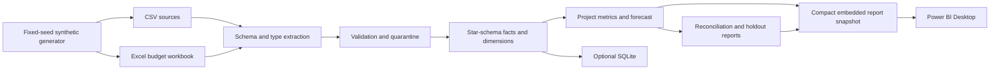

# Architecture and implementation plan

`run_pipeline.py` reads configuration, optionally regenerates the fixed-seed CSVs, extracts Excel and CSV sources, validates keys and dates, selects the approved budget version, produces a trailing-rate forecast, writes Power BI-ready CSVs, and writes refresh/audit reports. The included Excel budget workbook mirrors the standard-seed budget CSV. If the budget generation rules change, move that workbook aside so the pipeline reads the newly generated CSV. Source SHA-256, row counts, and byte sizes are captured in `reports/source_manifest.csv`.

The pipeline rewrites curated outputs from source each run. It does not append to facts, so rerunning unchanged inputs preserves row counts and financial totals. The test suite also compares output hashes. Exceptions have source row and reason. Invalid references, duplicate identifiers, malformed dates, and unsupported currencies are quarantined; valid negative cost corrections remain in the actual-cost fact.

The forecast uses the mean of the most recent three calendar months of net actual cost and projects that rate through each active project's planned end month. For a project with fewer than three observed months, it uses approved budget divided by planned months. Optimistic and downside multipliers are 0.85 and 1.20. The June 2026 snapshot uses only data known by June; July–September actuals provide a holdout evaluation. Forecasts are generated for the base, optimistic, and downside scenarios at both June and September snapshots. No probabilistic interval or causal claim is implied.

For the included report, open the PBIP and refresh its embedded snapshot. To reproduce it, run the generator and ETL, inspect reconciliation and exceptions, then run `python -m scripts.build_pbir` and `python -m scripts.validate_pbir`. The separate production blueprint in `docs/data_model.md` and `powerbi/dax/` describes a fuller star-schema model.
