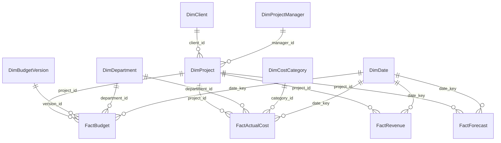

# Financial data model

Fact grains:

| Fact | One row represents | Unique key | Time key |
|---|---|---|---|
| FactBudget | One department allocation in one project budget version | `budget_record_id` | approval date |
| FactActualCost | One posted project cost or correction | `transaction_id` | transaction date |
| FactRevenue | One recognized revenue posting | `revenue_id` | recognition date |
| FactForecast | One project × snapshot × scenario × future month | `forecast_id` | future forecast month |

All relationships are one-to-many and single direction from dimension to fact. `DimClient` and `DimProjectManager` are small project outriggers; `DimProject` carries their keys. `DimBudgetVersion` also carries a project key for traceability but connects to `FactBudget` only by `version_id` in the active model. Do not create a second active path from project through budget version to budget. Date keys are integer `YYYYMMDD`; mark `DimDate[date]` as the date table after loading.

Every project has at least one approved version. The ETL chooses the most recent approval date, breaking ties by version number, as of `config/settings.json`'s `as_of_date`. `DimBudgetVersion[is_selected_approved]` marks that version. The lifetime budget measure sums only its department allocations and removes date filters. The time-series budget measure selects the latest approval **as of each displayed date**. Do not sum all versions together. The forecast measure sums only `is_latest_valid = TRUE` and the base scenario; scenario visuals intentionally choose a different multiplier.

Cost and revenue are dated and additive. Lifetime measures remove date filters so that a date slicer cannot silently turn a lifetime budget comparison into a partial-period comparison. Period measures retain date context for trends and growth. Forecast `date_key` represents a future month, while `snapshot_date` is a separate descriptive date. The model uses the former for forecast trend plots and the latest-snapshot flag for EAC.

