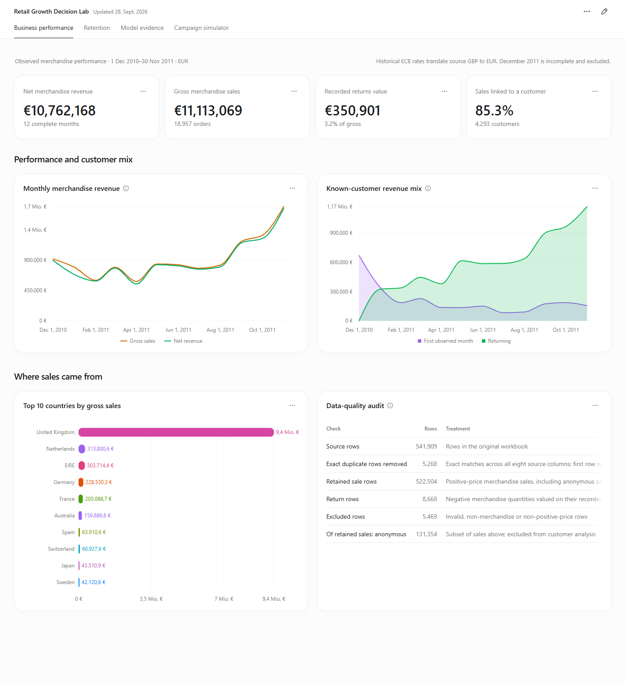
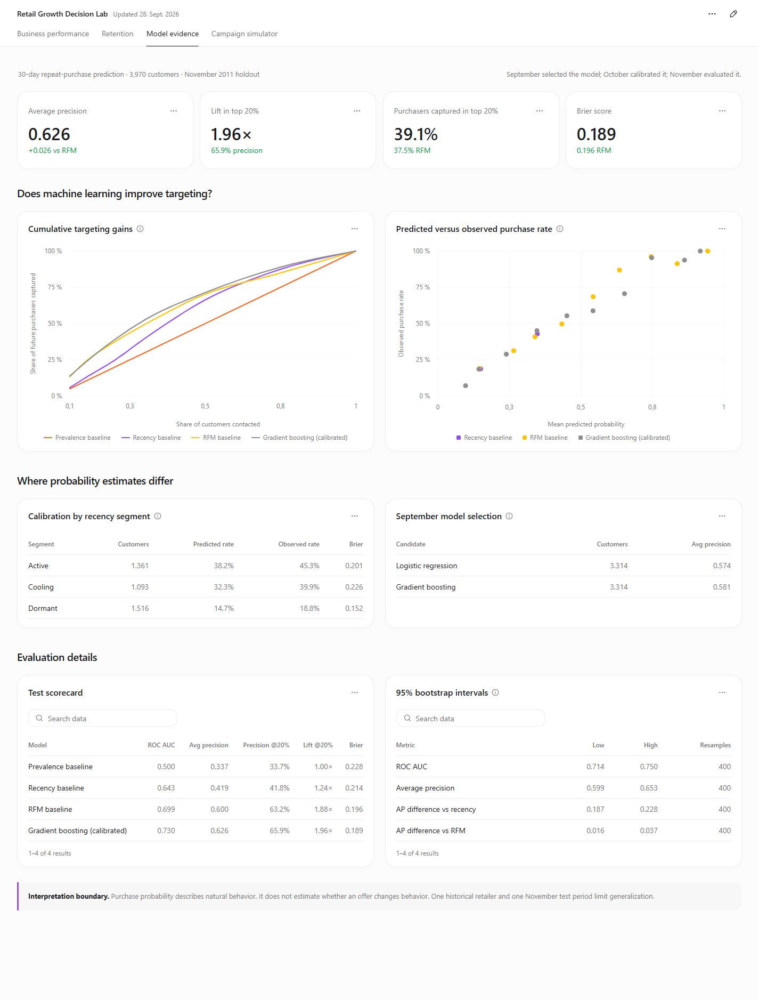

# Retail Growth Decision Lab

**Customer retention, repeat-purchase prediction, and campaign planning for an online retailer.**

Python · SQL · scikit-learn · React · Recharts · Historical EUR reporting

Retail teams often have more customers than they can afford to contact. This project examines what transaction history can tell them: how revenue and retention changed, which customers are likely to purchase again, and what assumptions an outreach campaign would need to break even.

The analysis uses **541,909 real UCI transaction records**. It includes a reconciled transaction ledger, executable SQL, time-based model evaluation, and a four-view dashboard. Monetary reporting is in euros using historical ECB reference rates.



## Explore the dashboard

Download the repository and open **`docs/demo/index.html`** in a browser. On Windows, double-click **`Open Dashboard.cmd`**. The included dashboard works offline and needs no Python or Node installation. GitHub's file viewer displays HTML source; [GitHub Pages setup](docs/github_setup.md) explains how to obtain a live browser link.

| View | Decision it supports |
|---|---|
| Business performance | Understand revenue, returns, customer coverage, and country mix |
| Retention | Compare first-observed-purchase cohorts without treating immature cells as zero |
| Model evidence | Compare machine learning with credible baselines and inspect calibration |
| Campaign simulator | Explore budget, contact cost, margin, uplift, and break-even assumptions |

## Results

For December 2010–November 2011, the retailer generated **€10.76M net merchandise revenue** from **18,957 orders**. Recorded returns were **€350.9K**, or **3.16% of gross sales**. November net revenue was **€1.66M**, up **36.4%** from October. The source does not establish the cause of that increase.

Identified customers accounted for **85.3%** of gross revenue. Weighted month-one retention across mature cohorts was **23.5%**. Anonymous sales remain in revenue totals but cannot enter customer retention or prediction.

### Does machine learning add value?

At the 1 November 2011 cutoff, the model predicted whether each known customer would make a valid positive purchase in the following 30 days.

| November holdout | Population baseline | Recency | RFM | Calibrated gradient boosting |
|---|---:|---:|---:|---:|
| Average precision | 0.337 | 0.419 | 0.600 | **0.626** |
| Precision in top 20% | 33.7% | 41.8% | 63.2% | **65.9%** |
| Purchasers captured in top 20% | 20.0% | 24.8% | 37.5% | **39.1%** |
| Lift in top 20% | 1.00× | 1.24× | 1.88× | **1.96×** |
| Brier score ↓ | 0.228 | 0.214 | 0.196 | **0.189** |

RFM is a strong baseline. The additional model complexity buys a modest improvement: about **2.6 percentage points in average precision**. The paired bootstrap 95% interval for that improvement is **0.016–0.037** within November. This does not establish performance across seasons or retailers.



### From prediction to a business decision

Purchase probability estimates natural behavior. It does **not** estimate how an offer changes behavior. The campaign simulator therefore uses an explicit, unvalidated priority heuristic—capped historical order value × non-purchase probability—and labels its economics as assumptions.

Budget and cost inputs are EUR. Exports include the currency and scenario assumptions. A [randomized experiment proposal](docs/experiment_plan.md) describes how to measure incremental contribution before adopting a targeting policy.

## Analytical design

```text
UCI transactions → audited GBP ledger → SQL revenue and retention outputs
                         │
                         ├→ ECB transaction-date conversion → EUR reporting
                         │
                         └→ historical customer snapshots → model evaluation
                                                                  │
EUR historical order values + purchase probabilities → campaign scenario
```

- **Training:** April–August 2011 snapshots; all features precede their cutoff.
- **Selection:** September average precision chooses logistic regression or gradient boosting.
- **Calibration:** October calibrates the selected model and fits the operational baselines.
- **Evaluation:** November is held out for the final 30-day prediction assessment.
- **Currency:** each sale and return is translated using its recorded date's ECB rate, with the latest prior rate on non-publication days. The model remains trained in original GBP; predictions are unchanged.

[Methodology](docs/methodology.md) · [Currency methodology](docs/currency_methodology.md) · [Data dictionary](docs/data_dictionary.md)

## Run locally

### Dashboard development

Node.js **22.12+** and npm are required to rebuild the dashboard:

```sh
npm run setup
npm run build
```

The build updates `dashboard/dist/index.html`, the offline export, and `docs/demo/index.html`. It uses the committed snapshot and does not need an external dashboard service. For a local server:

```sh
python -m http.server 4173 --bind 127.0.0.1 --directory dashboard/dist
```

### Reproduce the analysis

Use Python **3.11 or 3.12**. From the project root:

```sh
python -m venv .venv
# Windows: .venv\Scripts\activate
# macOS/Linux: source .venv/bin/activate
python -m pip install -r requirements.txt
python -m pipeline.run
npm run build
```

The first analysis run downloads the original UCI workbook. Raw inputs are checksum-verified. The bounded ECB historical-rate snapshot is included for reproducibility. `python -m pipeline.run --skip-ingest` reuses an existing audited ledger. Original GBP outputs and translated EUR outputs are retained separately.

### Checks

```sh
python -m pytest -q
npm test
```

Optional browser checks use Playwright and Microsoft Edge: install Playwright separately, start the local server, and run `node scripts/verify_dashboard.cjs`. `node scripts/verify_offline.cjs` checks the packaged file with network access disabled. See [validation notes](reports/validation.md) for actual checks performed.

## Repository guide

| Folder | Contents |
|---|---|
| `pipeline/` | Source ingestion, analytics, temporal ML, EUR conversion, snapshot assembly |
| `sql/` | Executed order, monthly, country, and cohort queries |
| `models/` | Model card, predictions, comparison metrics, uncertainty, candidate scores |
| `data/fx/` | ECB rates, date mapping, and source checksum |
| `dashboard/src/content/` | Project-specific analytical views and campaign calculations |
| `docs/` | Project context, methodology, experiment proposal, interview guide, and portable demo |
| `reports/` | Executive brief, screenshots, and validation record |
| `.github/workflows/` | Automated checks and manually triggered Pages deployment |

## Limits

This is one historical retailer, including wholesale customers, with one final test month. Net merchandise revenue is not profit. The source lacks product costs, margins, contact costs, campaign assignment, and contact consent. Exact duplicate removal is an explicit assumption because the source has no line identifier. Cohorts represent first **observed** purchase rather than proven acquisition. Neither model lift nor simulated contribution is evidence of achieved campaign impact.

## Sources and dependencies

[UCI Online Retail — Chen (2015), CC BY 4.0](https://doi.org/10.24432/C5BW33) · [ECB historical reference rates](https://www.ecb.europa.eu/stats/policy_and_exchange_rates/euro_reference_exchange_rates/html/index.en.html)

For the complete project handover, visual theme, decisions, results, and reproduction guide, see [Project Context](docs/PROJECT_CONTEXT.md). Data transformations and software dependencies are documented in [third-party notices](THIRD_PARTY_NOTICES.md). The dashboard retains source inspection, local editing, and theme controls.
