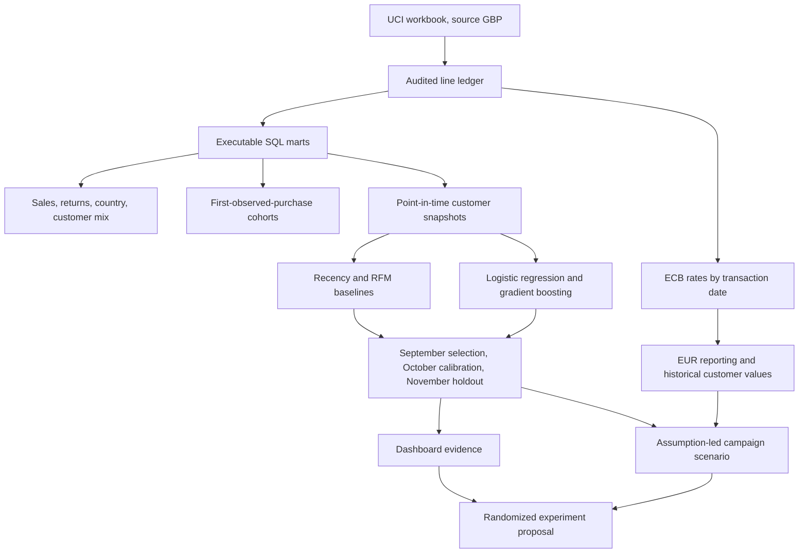

# Retail Growth Decision Lab: project context

## Project brief

Retail Growth Decision Lab is an analytical case study about customer growth at an online retailer. It starts with a practical constraint: a retailer cannot contact every customer, and observed purchase likelihood by itself does not establish who will change their behavior after an offer.

The project therefore answers the questions in sequence: what happened to sales, returns, and repeat purchasing; how well can the next 30 days of known-customer purchasing be ranked; how does machine learning compare with simpler rules; and what assumptions would a budget-limited campaign need to meet its break-even point? Its final recommendation is to use evidence to design a randomized campaign experiment, not to present model scores as achieved campaign lift.

The intended reader is a hiring manager or analytics teammate reviewing work from an experienced data analyst or data scientist. The project shows business framing, data-quality reasoning, executable SQL, time-aware predictive modelling, evaluation against baselines, uncertainty, a usable dashboard, and honest decision limits.

## Business question and decision

**Business question:** Can transaction history improve how a retailer plans customer outreach when contact capacity is limited, and what evidence is required before spending on a campaign?

**Prediction question:** At a historical decision point, will an existing identified customer make at least one valid positive purchase during the next 30 days?

**Decision boundary:** This is natural purchase propensity, not the incremental effect of treatment. The data has no offer assignment, campaign exposure, margin, contact cost, product cost, or consent. A controlled experiment must measure realized incremental contribution before the business adopts a targeting policy.

The simulator lets a reviewer change the eligible country, budget, contact cost, assumed margin, and assumed absolute uplift. It calculates a capped scenario in EUR, break-even uplift, a sensitivity table, and an exportable priority list. Those inputs and results are labelled as assumptions.

## Data and scope

The transaction source is Chen's [UCI Online Retail dataset](https://doi.org/10.24432/C5BW33), originally recorded in GBP. It has 541,909 source rows covering 1 December 2010 through 9 December 2011.

Ingestion removes 5,268 exact duplicate rows across all eight source fields, retaining the first row. That decision cannot be confirmed as accidental duplication because the source has no unique line identifier. The resulting 536,641 unique rows reconcile to 522,504 merchandise sales, 8,668 merchandise returns, and 5,469 exclusions. There are 131,354 anonymous sale rows among the retained sales. They remain in commercial reporting but cannot enter customer cohorts or prediction.

Commercial comparisons use the 12 complete months from 1 December 2010 through 30 November 2011. The incomplete final December is excluded. A valid sale is positive-quantity catalogue merchandise with a positive recorded unit price. Returns remain recorded on their own invoice dates: they are not matched to an inferred original sale. “Net merchandise revenue” means observed gross merchandise sales minus recorded merchandise returns; it is not accounting revenue or profit.

For customer-linked analysis, the transaction-date ECB reference rate converts every sale and return from GBP into EUR. The ECB quote is GBP per EUR, so `EUR = GBP / GBP per EUR`. For weekends and holidays, the most recent prior published rate is used; a later date is never used. There are 531,172 retained sale/return lines translated, and the greatest rate age is two days. The data dictionary and [currency methodology](currency_methodology.md) document the rates, date mapping, checksums, reconciliation, and limits.

The model itself was fitted and evaluated on the original GBP-valued features. Its scores and metrics are unchanged by the EUR reporting conversion. Historical order value for campaign planning is recomputed from translated EUR orders, so its training-period 95th-percentile cap is €1,076.19 and the customer ordering may differ from the original GBP scenario.

## Analytical workflow

### Commercial analysis and retention

SQL creates one invoice/customer order grain, monthly summaries, customer revenue mix, country summaries, and a first-observed-purchase cohort grid. Monthly totals and country gross totals reconcile independently against the ledger. An additional integrity check found no positive-sale invoice spanning two months or more than one identified customer.

Cohorts start in the month of a customer's first *observed* valid positive purchase. Earlier history is unavailable, so this is not proven acquisition. Retention divides active identified customers by original cohort size. Future age-month cells that have not matured are absent, whereas mature months with no purchases are recorded as zero.

The complete-month review reports €11.11M gross merchandise sales, €350.9K recorded returns, and €10.76M net merchandise revenue across 18,957 positive orders. The identified share is 85.3%; weighted month-one retention across mature cohorts is 23.5%. November is the highest-sales complete month, but the source does not explain why it increased.

### Predictive model

The target is at least one valid positive invoice in `[cutoff, cutoff + 30 days)`. Features use only transactions strictly before the cutoff. Customer ID is excluded from predictors. Repeated customers across monthly snapshots are intentional: the intended population is known customers, not new-customer cold start.

Features include recency, tenure, 30- and 90-day order counts, earlier-30-day order count, 90-day spend, active purchase days, historical order value, and a UK indicator. Positive-valued numeric features are log-transformed. The model selection metric is average precision, which summarizes the precision-recall trade-off for a ranked-contact use case.

- April–August monthly snapshots train the candidate models.
- September average precision selects between regularized logistic regression and histogram gradient boosting.
- October independently calibrates the selected model, sets the recency baseline, and fits a recent three-variable logistic RFM benchmark.
- November is an untouched 30-day outcome test set of 3,970 known customers; observed purchase prevalence is 33.7%.

On November, calibrated gradient boosting achieved 0.626 average precision, compared with 0.600 for RFM, 0.419 for recency, and 0.337 for prevalence. In the top-ranked 20%, its purchase precision was 65.9% versus 63.2% for RFM, capturing 39.1% versus 37.5% of purchasers. The model's paired customer bootstrap 95% interval for average-precision improvement over RFM is 0.016–0.037. That modest incremental gain should be considered against added model complexity.

The model card and [methodology](methodology.md) describe metrics, cutoffs, features, calibration, and limitations. Bootstrap intervals capture customer-sampling variation in November, not variation across time periods, retailers, or treatment assignments.

### Campaign scenario

The priority list ranks customers with `capped historical order value × (1 − purchase probability)`. This transparent value-times-nonpurchase heuristic is **not** the prediction model's gains ranking and has not been validated by the gains curve or an experiment. For an assumed absolute uplift `u` and estimated probability `p`, the simulator caps incremental order probability at `min(u, 1 − p)`. It calculates `Σ(incremental probability × historical order value × assumed margin) − contact spend`.

The starting scenario selects 1,000 customers, assumes a €1 contact cost, a 35% gross margin, and a 3 percentage-point absolute uplift. It yields 30 assumed incremental orders and roughly €6,955 scenario contribution after contact cost. That figure is an illustration; none of its uplift, margin, costs, or outcome is observed in the source. The [experiment proposal](experiment_plan.md) covers randomization, eligibility, outcomes, guardrails, and decision criteria.

## Dashboard purpose and navigation

The four dashboard views follow a reader's evidence path:

1. **Business performance:** net and gross merchandise totals, recorded returns, customer coverage, monthly sales and revenue mix, top countries, and row-treatment audit.
2. **Retention:** observed cohorts and an age-month heatmap with mature zeros distinguished from missing future months.
3. **Model evidence:** holdout metrics, cumulative gains, probability calibration, recency-segment diagnostics, September selection results, scorecard, and customer bootstrap intervals.
4. **Campaign simulator:** adjustable EUR assumptions, break-even absolute uplift, alternative-uplift sensitivity, country-filtered customer priorities, and a CSV export containing scenario assumptions.

Dashboard source-inspection actions expose the datasets, definitions, transformation methods, date coverage, and ECB provenance. Local edit and theme controls remain available. The standalone interface has no assistant or hosted-publishing controls.

## Visual theme: Pine & Paper

The theme treats the dashboard as a serious retail-analytics product. Soft paper backgrounds and restrained green accents suggest merchandise and financial reporting without using marketplace clip art, robot motifs, gradients as decoration, badges, invented company marks, or a fictional employer identity.

| Role | Light appearance | Dark appearance |
|---|---|---|
| Page background | Pale sage white `#F6F7F3` | Deep forest charcoal `#141B18` |
| Card surface | White `#FFFFFF` | Dark leaf `#1C2520` |
| Main ink | Deep green charcoal `#17231F` | Soft white `#EDF3ED` |
| Secondary ink | Muted green gray `#5E6D65` | Misty sage `#ABB9AF` |
| Action accent | Evergreen `#176B52` | Pale leaf `#A1CDB6` |
| Positive result | Deep green `#157451` | Soft mint `#84C9A4` |
| Negative result | Brick `#A64537` | Soft coral `#F28D83` |
| Borders and controls | Light sage gray | Forest gray |

The chart series use coordinated evergreen, ochre, slate blue, terracotta, olive, gold, brick, and gray. These distinguish multiple measures while staying legible on both surfaces. Chart colors describe series; they do not assign an unsupported business meaning to a category. Positive and negative tones are reserved for explicitly favorable or unfavorable scenario contribution; observed trends keep their series colors.

Inter is the first typeface preference, followed by installed system sans-serif fonts; no external font service is required. Cards use restrained shadows and 12–16px corner radii, with 10px controls. Layout uses four columns for desktop KPI cards, one column on narrow phones, wrapped scenario controls, and tables that scroll inside their cards. Retention heatmap cells deliberately scroll inside the table rather than forcing the whole mobile page wider.

Implementation lives in `dashboard/src/theme.css` and `dashboard/src/content/dashboard/dashboard.css`. The shell's normal theme control can still switch appearance. Theme palette, chart colors, currency, labels, and examples must remain consistent when future dashboard views are added.

## What the project contains

- **Reproducible data:** the checksum-recorded UCI source, deterministic classification, SQLite transaction ledger, row reconciliation, and quality summary.
- **Executable analytics:** SQL orders, country, monthly, customer-mix, and cohort queries; ledger reconciliation; and separate GBP/EUR outputs.
- **Machine learning:** point-in-time feature engineering, prevalence/recency/RFM baselines, candidate selection, probability calibration, independent holdout scoring, uncertainty estimates, segments, and a model card.
- **Currency:** a versioned extract of ECB historical GBP-per-EUR reference rates, as-of transaction-date mapping, integrity hashes, and EUR aggregates/customer order values.
- **Interactive dashboard:** four evidence views, source information, assumptions and reset, country filtering, breakpoint-aware tables, and an assumptions-aware CSV export.
- **Project materials:** executive brief, methodology, currency guide, data dictionary, experiment plan, interview guide, validation notes, screenshots, and GitHub upload/deployment instructions.
- **Build and release:** pinned Python and npm dependencies, automated quality-check and manual Pages workflows, a reproducible source build, local offline HTML, Windows launcher, and GitHub ZIP package.

The GitHub Actions workflows are prepared but have not run on GitHub. The repository has not been published. No campaign has been run, and no business outcome has been observed from an outreach intervention.

## Key files

| Path | Purpose |
|---|---|
| `README.md` | Public project introduction, evidence, and quick-start instructions |
| `pipeline/ingest.py` | UCI acquisition, audit, classification, and SQLite build |
| `pipeline/analytics.py` and `sql/` | Commercial, customer, and cohort results |
| `pipeline/model.py` and `models/` | Time-split learning, metrics, model card, scored candidates |
| `pipeline/currency.py` and `data/fx/` | ECB rates, GBP-to-EUR conversion, and conversion audit |
| `pipeline/build_dashboard_data.py` | Evidence snapshot, definitions, calculations, and provenance |
| `dashboard/src/content/dashboard/` | Project-specific views and campaign calculations |
| `dashboard/src/theme.css` | Pine & Paper palette and typography tokens |
| `docs/experiment_plan.md` | Proposed randomized campaign experiment |
| `docs/interview_guide.md` | Interview opening and design answers |
| `reports/validation.md` | Checks actually performed and delivery boundaries |

## Reproduce the work

Use Python 3.11 or 3.12. Create and activate a virtual environment, install `requirements.txt`, and run `python -m pipeline.run`. This downloads and checks the published UCI source if the workbook is not already present, processes the transaction ledger, reruns SQL and model evaluation, applies the included ECB rate snapshot, assembles the reviewed dashboard data, and runs the Python tests.

With Node.js 22.12 or later, `npm run setup` installs the pinned dashboard dependencies and `npm run build` verifies the source, builds the standalone dashboard, and refreshes its offline and GitHub Pages files. `npm test` runs the four campaign-calculation tests.

For a portfolio walk-through, start with the business question and business-performance view, explain why the RFM benchmark is strong, show the November holdout and uncertainty, then use the simulator to demonstrate how its break-even answer changes with assumptions. Close by distinguishing what the data supports from what an experiment must establish.

## Project boundaries

The result is a reproducible historical retail case study, not a live retailer system. It has one old retailer and one final test month, limited invoice history, no observed margin or marketing-treatment data, and a transparent but experimentally unvalidated contact heuristic. Net merchandise revenue is not profit. The required UCI, ECB, and software dependency notices remain part of the project so original research and third-party components are credited accurately.
